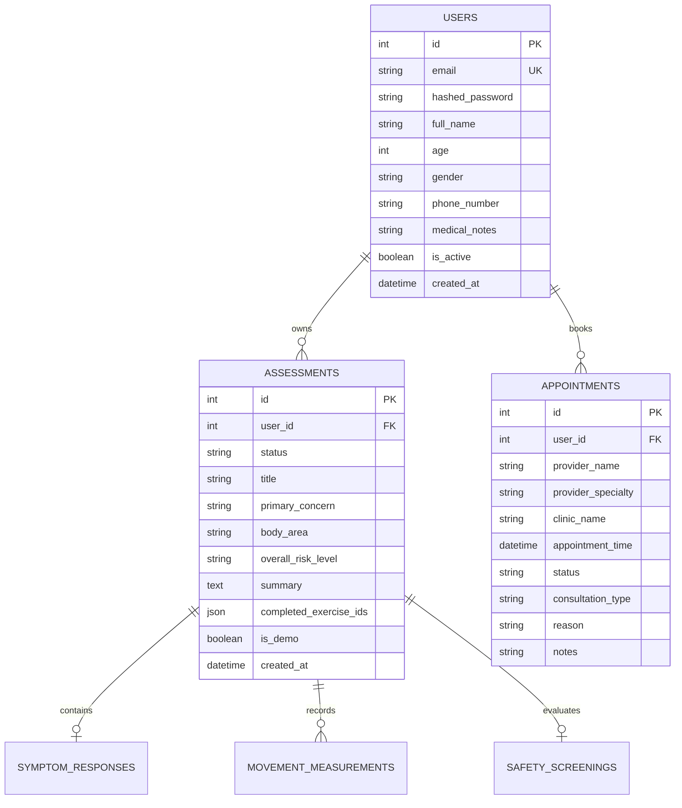

# MetroHealth AI – Complete Technical Architecture, Implementation & Rebuild Handbook
## (AI-Powered Hospital Physiotherapy & Posture Assessment System)

---

## 📑 TABLE OF CONTENTS
1. [Executive Summary & High-Level System Architecture](#1-executive-summary--high-level-system-architecture)
2. [Master Technology Matrix (What, Why, and How)](#2-master-technology-matrix-what-why-and-how)
   - [Programming Languages & Runtimes](#programming-languages--runtimes)
   - [Frontend Frameworks & Ecosystem](#frontend-frameworks--ecosystem)
   - [Backend Architecture & Frameworks](#backend-architecture--frameworks)
   - [Computer Vision & Biomechanics Engine](#computer-vision--biomechanics-engine)
   - [Database & Storage Layer](#database--storage-layer)
   - [Security, Cryptography & Auth Protocol](#security-cryptography--auth-protocol)
   - [DevOps, Tools & Infrastructure (Docker, Postman, VS Code, Git)](#devops-tools--infrastructure)
3. [Deep-Dive: How Computer Vision & Biomechanics Work](#3-deep-dive-how-computer-vision--biomechanics-work)
   - [MediaPipe 33-Landmark Pose Model](#mediapipe-33-landmark-pose-model)
   - [Mathematical Formulas for Joint Angles & Symmetry](#mathematical-formulas-for-joint-angles--symmetry)
   - [Client-Side Privacy Preservation](#client-side-privacy-preservation)
   - [Browser Speech Synthesis Voice Guidance](#browser-speech-synthesis-voice-guidance)
4. [Deep-Dive: Clinical Triage & Safety Rule Engine](#4-deep-dive-clinical-triage--safety-rule-engine)
5. [Database Architecture & Entity-Relationship Schema](#5-database-architecture--entity-relationship-schema)
6. [Complete REST API Reference & Postman Testing Guide](#6-complete-rest-api-reference--postman-testing-guide)
7. [Zero-to-One Step-by-Step Rebuild Guide (From Scratch)](#7-zero-to-one-step-by-step-rebuild-guide-from-scratch)
   - [Phase 1: Environment & Project Scaffolding](#phase-1-environment--project-scaffolding)
   - [Phase 2: Developing the Backend Engine](#phase-2-developing-the-backend-engine)
   - [Phase 3: Developing the Hospital Frontend Portal](#phase-3-developing-the-hospital-frontend-portal)
   - [Phase 4: Integrating MediaPipe Vision & Speech](#phase-4-integrating-mediapipe-vision--speech)
   - [Phase 5: Automated Testing & Verification](#phase-5-automated-testing--verification)
   - [Phase 6: Cloud Deployment & Publishing](#phase-6-cloud-deployment--publishing)

---

## 1. Executive Summary & High-Level System Architecture

**MetroHealth AI** is an enterprise-grade digital health web platform designed for hospital physiotherapy departments, orthopedic posture evaluations, and rehabilitation follow-ups.

### Architectural Philosophy
1. **Zero Raw Video Transmission (100% Client-Side Privacy):** Webcam video frames are processed entirely inside the browser's JavaScript WebAssembly thread using MediaPipe. Video or pictures are never uploaded to the hospital server. Only computed numerical angles (e.g. `shoulder_tilt = 2.4°`) are sent.
2. **Clinical Safety Gates:** The software separates educational mobility from emergency medicine. If red-flag symptoms (FAST stroke, cauda equina, heart attack) are detected, exercises are blocked, and emergency numbers (**100 / 112 / 108**) are presented.
3. **Strict Multi-Tenant Isolation (IDOR Protection):** Every patient can only view, edit, or delete their own medical records, appointments, and exercise plans.

### System Architecture Diagram

```mermaid
flowchart TD
    subgraph Client ["Client Browser (React 18 + Vite + TypeScript)"]
        UI["Hospital UI & Dashboard"]
        Cam["Webcam Video Feed"]
        MP["MediaPipe Pose (WASM Engine)"]
        Speech["Web Speech Synthesis (Voice Prompts)"]
        Cam --> MP
        MP --> UI
        Speech --> UI
    end

    subgraph ReverseProxy ["Vite Dev / Nginx Reverse Proxy"]
        Proxy["/api Reverse Proxy (Port 5173 -> 8000)"]
    end

    subgraph Backend ["Backend API (FastAPI + Python 3.11)"]
        AuthRouter["/api/auth (JWT, PBKDF2 Hashing)"]
        AssessRouter["/api/assessments (CRUD, IDOR Guard)"]
        ApptRouter["/api/appointments (Booking & Conflict Engine)"]
        SafetyRouter["/api/safety (Rule-Based Triage Engine)"]
        CVRouter["/api/cv (Kinematic Metric Analyzer)"]
        ExerciseService["Exercise Knowledgebase Service"]
    end

    subgraph Database ["Relational Storage (SQLAlchemy ORM)"]
        DB[("SQLite (Dev) / PostgreSQL (Prod)")]
    end

    UI -->|HTTP / REST (Bearer JWT)| Proxy
    Proxy --> Backend
    AuthRouter --> DB
    AssessRouter --> DB
    ApptRouter --> DB
    AssessRouter --> SafetyRouter
    AssessRouter --> ExerciseService
```

---

## 2. Master Technology Matrix (What, Why, and How)

### Programming Languages & Runtimes

| Technology | What it is | Why we chose it (Reason) | How it is used in the app |
|---|---|---|---|
| **Python (3.11+)** | High-level interpreted programming language. | Industry gold standard for Healthcare AI, Computer Vision, mathematical operations (NumPy), and asynchronous APIs. | Powers the entire backend logic, biomechanical angle parsing, security middleware, and database ORM. |
| **TypeScript (5.7+)** | Statically typed superset of JavaScript. | Prevents runtime bugs, ensures strict typing for medical data, coordinates, and API responses. | Used across all frontend components, state managers, hooks, and API definitions. |
| **JavaScript (ESNext)** | Native browser scripting language. | Runs in all web browsers natively without installation. | Powers WebAssembly execution for MediaPipe and the browser Web Speech API. |
| **HTML5 & Canvas API** | Standard web presentation and 2D drawing markup. | Allows real-time 60fps rendering of skeletal joints directly over the live webcam video element. | Used in `PostureCanvas.tsx` to draw landmarks, connection lines, and target angles. |

---

### Frontend Frameworks & Ecosystem

| Technology | What it is | Why we chose it | How it is used in the app |
|---|---|---|---|
| **React 18** | Component-based UI library. | Virtual DOM for high performance, reactive state updates, and reusable component structure. | Renders Dashboard, Assessment Wizard, Body Map, Exercise Lists, and Login flows. |
| **Vite 6** | Ultra-fast frontend build tool and development server. | Instant Hot Module Replacement (HMR) and fast build times compared to legacy Webpack. | Bundles TypeScript and React into optimized JS/CSS bundles (`dist/`) and provides `/api` reverse proxy. |
| **Tailwind CSS 3** | Utility-first CSS framework. | Eliminates messy custom CSS files, guarantees consistent hospital color palette, and is fully responsive. | Styles the entire UI: colors (`teal-600`, `slate-900`), borders, grids, cards, and animations. |
| **Lucide React** | Modern, clean SVG icon library. | Lightweight, consistent medical and functional icons without bulky icon fonts. | Displays medical stethoscope, camera, activity pulse, dumbbell, lock, and emergency icons. |
| **Web Speech API** | Native browser audio synthesis engine. | Zero latency, no external cloud API costs, works completely offline inside the browser. | Speaks step-by-step movement instructions out loud to the patient while they stand in front of the camera. |

---

### Backend Architecture & Frameworks

| Technology | What it is | Why we chose it | How it is used in the app |
|---|---|---|---|
| **FastAPI (0.115+)** | High-performance asynchronous Python web framework based on Starlette. | Generates automatic OpenAPI/Swagger documentation, uses Pydantic validation, and delivers 3x faster response times than Flask/Django. | Serves all REST endpoints (`/api/auth`, `/api/assessments`, `/api/appointments`, `/api/cv`, etc.). |
| **Uvicorn** | Lightning-fast ASGI web server implementation for Python. | Handles asynchronous HTTP requests concurrently with minimal memory footprint. | Serves the FastAPI application on `127.0.0.1:8000`. |
| **Pydantic V2** | Data validation and parsing library using Python type annotations. | Enforces strict validation of all incoming inputs (e.g. email format, password length, pain scale 0–10). | Defined in `backend/app/schemas/` to serialize and validate request and response bodies. |
| **SQLAlchemy 2.0** | Python SQL Toolkit and Object-Relational Mapper (ORM). | Eliminates raw SQL injection vulnerabilities and provides a database-agnostic interface (SQLite -> PostgreSQL). | Manages `User`, `Assessment`, `Appointment`, and `SymptomResponse` relational database models. |

---

### Computer Vision & Biomechanics Engine

| Technology | What it is | Why we chose it | How it is used in the app |
|---|---|---|---|
| **Google MediaPipe Pose** | Deep-learning on-device pose estimation pipeline. | Detects 33 skeletal body landmarks in real-time at 30–60 FPS directly on the CPU/GPU via WebAssembly. | Tracks shoulders, elbows, wrists, hips, knees, and ankles through the user's webcam. |
| **NumPy** | High-performance numerical mathematics library for Python. | Vectorized calculations of 3D trigonometric angles and Euclidean distance matrices. | Used in `CVAnalyzer` for verifying angles, confidence scoring, and outlier detection. |

---

### Database & Storage Layer

| Technology | What it is | Why we chose it | How it is used in the app |
|---|---|---|---|
| **SQLite (Default Dev)** | Serverless, zero-configuration embedded SQL database engine. | Requires no external database server installation, perfect for local development and self-contained testing. | Stored at `backend/healthsense.db`. |
| **PostgreSQL (Production Ready)** | Enterprise-grade open-source relational database. | Supports concurrent patient access, row-level locking, ACID compliance, and Docker deployment. | Configured via `DATABASE_URL` environment variable for cloud deployment. |

---

### Security, Cryptography & Auth Protocol

| Technology | What it is | Why we chose it | How it is used in the app |
|---|---|---|---|
| **PBKDF2-HMAC-SHA256 & Bcrypt** | Password hashing algorithms with per-user salt and 100,000 work factor rounds. | Protects patient passwords against dictionary attacks and rainbow tables. Plaintext passwords are never saved. | Handled via `passlib[bcrypt]` in `backend/app/core/security.py`. |
| **PyJWT (JSON Web Tokens)** | Compact, URL-safe tokens signed with HMAC-SHA256 (`HS256`). | Stateless authentication: the server verifies client identity without requiring server-side session stores. | Encodes user ID and expiration in the `Authorization: Bearer <token>` HTTP header. |
| **IDOR Protection Engine** | Server-side ownership validation logic. | Ensures User A cannot view, modify, or delete User B's clinical records by guessing assessment IDs. | Handled in `assessments.py` and `appointments.py` via `if record.user_id != current_user.id: raise 403 Forbidden`. |
| **OWASP Password Reset Guard** | Anti-enumeration and account takeover defense pattern. | Prevents hackers from guessing valid patient emails or resetting passwords without verification. | Implemented in `POST /api/auth/forgot-password`. |

---

### DevOps, Tools & Infrastructure

| Tool | What it is | Why we chose it | How it is used in the app |
|---|---|---|---|
| **Docker & Docker Compose** | OS-level virtualization platform. | Guarantees identical execution environment on Windows, Linux, and macOS without "works on my machine" issues. | Multi-container setup in `docker-compose.yml` (`backend` on Python alpine, `frontend` on Nginx). |
| **Postman / Swagger UI** | API design, testing, and debugging platforms. | Allows testing every backend endpoint with headers, payloads, and tokens before frontend integration. | Available automatically at `http://127.0.0.1:8000/docs` (interactive Swagger UI). |
| **Git & GitHub** | Distributed version control system. | Tracks code changes, enables team collaboration, and integrates with CI/CD deployment pipelines. | Configured with `.gitignore` on the `main` branch. |
| **VS Code** | Modern source code editor. | Built-in terminal, multi-folder workspace, TypeScript intelligence, and debugger configurations. | Configured via `.vscode/launch.json` and `.vscode/tasks.json`. |

---

## 3. Deep-Dive: How Computer Vision & Biomechanics Work

### MediaPipe 33-Landmark Pose Model
MediaPipe tracks 33 normalized coordinates $(x, y, z)$ where:
- $x, y \in [0.0, 1.0]$ represent normalized image coordinates (relative to width and height).
- $z$ represents depth relative to the mid-hip landmark.
- `visibility` $\in [0.0, 1.0]$ represents the confidence that the joint is not occluded.

```
       0 (Nose)
     1   4
   2       5 (Eyes)
 3           6
     7   8 (Ears)
       |
 11 (L.Shoulder) ─────── 12 (R.Shoulder)
   |                       |
 13 (L.Elbow)            14 (R.Elbow)
   |                       |
 15 (L.Wrist)            16 (R.Wrist)
       |
 23 (L.Hip) ──────────── 24 (R.Hip)
   |                       |
 25 (L.Knee)             26 (R.Knee)
   |                       |
 27 (L.Ankle)            28 (R.Ankle)
```

### Mathematical Formulas for Joint Angles & Symmetry

#### 1. Shoulder Horizontal Tilt Angle ($\theta_{\text{shoulder}}$)
Measures shoulder asymmetry or elevation:
$$\theta_{\text{shoulder}} = \left| \arctan\left(\frac{y_{\text{right\_shoulder}} - y_{\text{left\_shoulder}}}{x_{\text{right\_shoulder}} - x_{\text{left\_shoulder}}}\right) \right| \times \frac{180^\circ}{\pi}$$
- $\theta < 3.0^\circ$: Balanced shoulder level.
- $\theta \ge 5.0^\circ$: Significant elevation or postural scoliosis/asymmetry.

#### 2. Hip / Pelvic Tilt Angle ($\theta_{\text{hip}}$)
$$\theta_{\text{hip}} = \left| \arctan\left(\frac{y_{\text{right\_hip}} - y_{\text{left\_hip}}}{x_{\text{right\_hip}} - x_{\text{left\_hip}}}\right) \right| \times \frac{180^\circ}{\pi}$$

#### 3. Joint Flexion Angle (Knee or Elbow 3-Point Angle)
Given three 2D points $A$ (Hip), $B$ (Knee), and $C$ (Ankle), we compute the vectors:
$$\mathbf{u} = \vec{BA} = (x_A - x_B, y_A - y_B), \quad \mathbf{v} = \vec{BC} = (x_C - x_B, y_C - y_B)$$
Using the dot product formula:
$$\cos \theta = \frac{\mathbf{u} \cdot \mathbf{v}}{\|\mathbf{u}\| \|\mathbf{v}\|} = \frac{u_x v_x + u_y v_y}{\sqrt{u_x^2 + u_y^2} \sqrt{v_x^2 + v_y^2}}$$
$$\theta = \arccos(\text{clamp}(\cos \theta, -1.0, 1.0)) \times \frac{180^\circ}{\pi}$$

#### 4. Bilateral Symmetry Score (%)
Computes overall posture equilibrium:
$$\text{Symmetry Score} = \max\left(0, 100 - \left( \theta_{\text{shoulder}} \times 4.0 + \theta_{\text{hip}} \times 4.0 \right) \right)$$

---

### Browser Speech Synthesis Voice Guidance
To prevent patients from having to stare closely at small text on screen while standing 6–8 feet away:
```typescript
// frontend/src/components/PostureCanvas.tsx
export const speakInstruction = (text: string) => {
  if (!('speechSynthesis' in window)) return;
  window.speechSynthesis.cancel(); // Clears any previously queued audio
  const utterance = new SpeechSynthesisUtterance(text);
  utterance.rate = 0.95; // Clear, calm clinical tempo
  utterance.pitch = 1.0;
  window.speechSynthesis.speak(utterance);
};
```

---

## 4. Deep-Dive: Clinical Triage & Safety Rule Engine

Located in `backend/app/services/safety_engine.py`.

### Safety Screening Logic
The `SafetyEngine` evaluates clinical red flags prior to allowing exercise generation:

```
Patient Symptoms Input
         │
         ▼
[Are any Red Flags Checked?] ───► YES ───► [Categorize Referral Urgency]
         │                                       ├── "emergency": Halts all exercises. Shows 100 / 112 / 108.
         │                                       └── "urgent_physician": Advises in-person clinic visit.
         NO
         │
         ▼
[Check Pain Severity (VAS 0-10)]
         ├── Severity >= 8  ──► "urgent_physician" (Exercise blocked)
         ├── Severity 5 - 7 ──► "physiotherapist" (Gentle recovery exercises)
         └── Severity 0 - 4 ──► "self_care" (Mobility & posture routines)
```

---

## 5. Database Architecture & Entity-Relationship Schema



---

## 6. Complete REST API Reference & Postman Testing Guide

### Base URL: `http://127.0.0.1:8000/api`

| Endpoint | Method | Auth Required | Description |
|---|---|---|---|
| `/auth/register` | `POST` | No | Creates a new patient account with hashed password. |
| `/auth/login` | `POST` | No | Authenticates via email or phone + password; returns JWT token. |
| `/auth/me` | `GET` | Yes (Bearer) | Retrieves the authenticated patient's profile. |
| `/auth/me` | `PUT` | Yes (Bearer) | Updates patient profile details (name, age, phone). |
| `/auth/change-password` | `PUT` | Yes (Bearer) | Verifies current password and updates to new password. |
| `/auth/forgot-password` | `POST` | No | Secure recovery request (anti-enumeration protected). |
| `/assessments` | `POST` | Yes (Bearer) | Submits symptom questionnaire + posture kinematics; saves assessment. |
| `/assessments` | `GET` | Yes (Bearer) | Lists all historical assessments belonging to the logged-in user. |
| `/assessments/{id}` | `GET` | Yes (Bearer) | Retrieves a specific assessment (IDOR ownership check enforced). |
| `/assessments/{id}/exercise-progress` | `PUT` | Yes (Bearer) | Updates completed exercise task IDs. |
| `/assessments/{id}` | `DELETE` | Yes (Bearer) | Permanently deletes an assessment record. |
| `/appointments` | `GET` | Yes (Bearer) | Lists all appointments belonging to the logged-in user. |
| `/appointments` | `POST` | Yes (Bearer) | Schedules an appointment with automated conflict detection. |
| `/appointments/{id}/cancel` | `PUT` | Yes (Bearer) | Cancels an upcoming appointment. |
| `/appointments/{id}/reschedule` | `PUT` | Yes (Bearer) | Reschedules an appointment to a new time slot. |
| `/cv/analyze-pose` | `POST` | No | Stateless biomechanical analysis of 33 normalized landmarks. |
| `/safety/screen` | `POST` | No | Rule-based clinical triage evaluation. |

### How to Test in Postman

1. **Step 1 - Register or Login:**
   - In Postman, create a `POST` request to `http://127.0.0.1:8000/api/auth/login`.
   - Body (`raw JSON`):
     ```json
     {
       "email": "adamcarter32@gmai.com",
       "password": "HealthSense2026!"
     }
     ```
   - Click **Send**.
   - Copy the `access_token` string from the response.

2. **Step 2 - Authenticate Subsequent Requests:**
   - In any protected request (e.g. `GET http://127.0.0.1:8000/api/assessments`):
   - Switch to the **Authorization** tab.
   - Type: **Bearer Token**.
   - Paste your token into the **Token** field.
   - Click **Send**.

---

## 7. Zero-to-One Step-by-Step Rebuild Guide (From Scratch)

Agar aapko yeh project zero se khud develop karna ho bina kisi help ke, toh yeh complete sequence follow karein:

### Phase 1: Environment & Project Scaffolding

```bash
# 1. Workspace directory create karein
mkdir "MetroHealth-AI"
cd "MetroHealth-AI"

# 2. Git initialize karein
git init

# 3. Backend folder scaffold karein
mkdir backend
cd backend
python -m venv venv
venv\Scripts\activate

# 4. requirements.txt create karein:
# fastapi, uvicorn[standard], sqlalchemy, pydantic, passlib[bcrypt], bcrypt, pyjwt, python-multipart, numpy
pip install -r requirements.txt
cd ..

# 5. Frontend scaffold karein (Vite + React + TypeScript)
npm create vite@latest frontend -- --template react-ts
cd frontend
npm install
npm install lucide-react clsx tailwind-merge @mediapipe/pose @mediapipe/camera_utils
npm install -D tailwindcss postcss autoprefixer
npx tailwindcss init -p
cd ..
```

---

### Phase 2: Developing the Backend Engine

1. **`backend/app/core/config.py`**:
   - Define `Settings` using Pydantic: `SECRET_KEY`, `ALGORITHM = "HS256"`, `ACCESS_TOKEN_EXPIRE_MINUTES = 1440`, `DATABASE_URL`.
2. **`backend/app/core/database.py`**:
   - Setup SQLAlchemy `create_engine()`, `SessionLocal = sessionmaker(...)`, and `Base = declarative_base()`.
3. **`backend/app/core/security.py`**:
   - `hash_password(password)`: uses `pwd_context.hash(password)`.
   - `verify_password(plain, hashed)`: uses `pwd_context.verify(plain, hashed)`.
   - `create_access_token(data, expires_delta)`: uses `jwt.encode(to_encode, SECRET_KEY, algorithm="HS256")`.
4. **`backend/app/models/`**:
   - `user.py`: Define `User` with `id`, `email`, `hashed_password`, `full_name`, `phone_number`.
   - `assessment.py`: Define `Assessment`, `SymptomResponse`, `MovementMeasurement`, `SafetyScreening`.
   - `appointment.py`: Define `Appointment`.
5. **`backend/app/core/deps.py`**:
   - Implement `get_current_user`: extracts Bearer token, decodes JWT, verifies user in DB, returns `User` object.
6. **`backend/app/api/`**:
   - Build `auth.py`: `/register`, `/login`, `/me`, `/change-password`, `/forgot-password`.
   - Build `assessments.py`: Enforce `Assessment.user_id == current_user.id` on all CRUD operations.
   - Build `appointments.py`: Implement conflict-checking query before committing booking.
   - Build `cv.py` and `safety.py`: Biomechanical angle calculator and rule triage.
7. **`backend/app/main.py`**:
   - Mount CORS middleware, security headers middleware, and include `api_router`.

---

### Phase 3: Developing the Hospital Frontend Portal

1. **Configure Tailwind & Theme:**
   - In `tailwind.config.js`, configure hospital colors (`teal`, `slate`, `cyan`).
2. **Setup API Client (`frontend/src/services/api.ts`):**
   - Create typed fetch wrapper with `Authorization: Bearer ${localStorage.getItem('healthsense_token')}`.
3. **Setup Auth State (`frontend/src/context/AuthContext.tsx`):**
   - Manage `user`, `token`, `login()`, `register()`, `logout()`, `refreshUser()`.
4. **Build Core Views:**
   - `LoginPage.tsx`: Dual-panel hospital branding with email/mobile login and forgot-password modal.
   - `DashboardPage.tsx`: Welcome section, assessment shortcuts, active exercise cards, appointment reminders.
   - `Sidebar.tsx` & `HospitalHeader.tsx`: Navigation bar with 24/7 clinic helpline (`+91 9653766889`).
   - `HistoryPage.tsx`: Historical records with delete and filter options.
   - `MyExercisesPage.tsx`: 3-day recovery program with interactive completion checkboxes.

---

### Phase 4: Integrating MediaPipe Vision & Speech

1. **Create `PostureCanvas.tsx`:**
   - Render a mirrored `<video>` tag for webcam preview.
   - Overlay an absolute `<canvas>` for skeletal stick-figure rendering.
   - Initialize MediaPipe `Pose`:
     ```typescript
     const pose = new Pose({
       locateFile: (file) => `https://cdn.jsdelivr.net/npm/@mediapipe/pose/${file}`
     });
     pose.setOptions({
       modelComplexity: 1,
       smoothLandmarks: true,
       minDetectionConfidence: 0.65,
       minTrackingConfidence: 0.65
     });
     ```
   - Connect camera with `Camera(videoElement, { onFrame: async () => await pose.send({ image: videoElement }) })`.
2. **Add Voice Speech Guidance:**
   - Add `speakInstruction(text)` utilizing `window.speechSynthesis`.
   - Trigger prompts based on the patient's selected problem area (e.g. *"Stand straight, look directly ahead, relaxing your neck and shoulders"*).

---

### Phase 5: Automated Testing & Verification

1. **Verify Backend:**
   - Run tests: `pytest backend/tests/`.
2. **Verify Frontend:**
   - Run type-checker and build: `npm --prefix frontend run build`.
   - Verify `0 errors` and successful bundling.

---

### Phase 6: Cloud Deployment & Publishing

1. **Deploy Frontend on Vercel:**
   - Connect GitHub repository.
   - Set framework to **Vite**.
   - Output directory: `dist`.
2. **Deploy Backend on Render / Railway:**
   - Select Python web service.
   - Build command: `pip install -r requirements.txt && python init_db.py`.
   - Start command: `uvicorn app.main:app --host 0.0.0.0 --port $PORT`.

---

## 8. Summary of Key Hospital Configurations
- **Hospital Clinic Helpline:** `+91 9653766889`
- **National Emergency Dispatch:** `100 / 112 / 108`
- **Default Database:** SQLite (`backend/healthsense.db`)
- **Default Port Mappings:** Frontend: `5173`, Backend: `8000`
